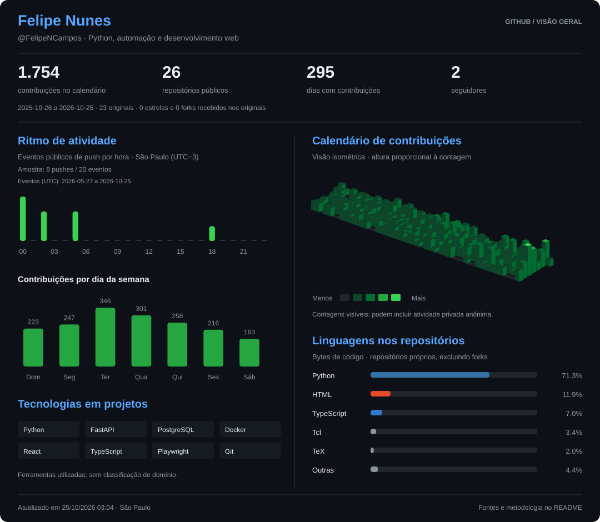

# Felipe Nunes Campos

**Engenheiro de Software**

Meus projetos públicos incluem bots, coleta de dados e aplicações web.   
Trabalho com Python e FastAPI no backend e com React e TypeScript em interfaces.

[Portfólio](https://felipencampos.github.io/portifolio/) · [LinkedIn](https://www.linkedin.com/in/felipe-nunes-campos-b25945332) · [Repositórios](https://github.com/FelipeNCampos?tab=repositories)

  

Dados visíveis no GitHub · Atualização programada a cada seis horas após publicação · [Fontes e metodologia](#fontes-e-metodologia)

## Projetos selecionados

| Projeto | O que demonstra | Tecnologias |
| :--- | :--- | :--- |
| [Morcegão — bot para Discord](https://github.com/FelipeNCampos/DiscordBot) | Automações de comunidade, integração com Twitch e Instagram, webhooks e persistência | Python · FastAPI · SQLite |
| [Coletor Facebook](https://github.com/FelipeNCampos/guaia-facebook-collector-develop) | Descoberta de links, extração de dados e processamento assíncrono com persistência transacional | Python · Selenium · FastAPI · PostgreSQL |
| [CRM Backend](https://github.com/FelipeNCampos/CRM-Monolito-Micro_service) | Autenticação, controle de acesso, contatos, oportunidades, relatórios e auditoria em módulos de domínio | Python · FastAPI · SQLAlchemy · PostgreSQL · Docker |
| [Portfólio](https://github.com/FelipeNCampos/portifolio) | Interface para apresentar projetos e experiências, com publicação estática no GitHub Pages | React · TypeScript · Vite |

<strong>Ferramentas e áreas de interesse</strong>

- **Backend e dados:** Python, FastAPI, PostgreSQL, MySQL e SQLite.
- **Interfaces:** React, TypeScript, JavaScript, HTML, CSS e Sass.
- **Automação e qualidade:** Playwright, Selenium, BeautifulSoup e pytest.
- **Entrega e versionamento:** Docker, Git, GitHub e GitHub Pages.

As ferramentas refletem os projetos públicos e as preferências já apresentadas neste perfil. Não representam classificações de proficiência.

<strong>Mais sobre mim</strong>

  
  

